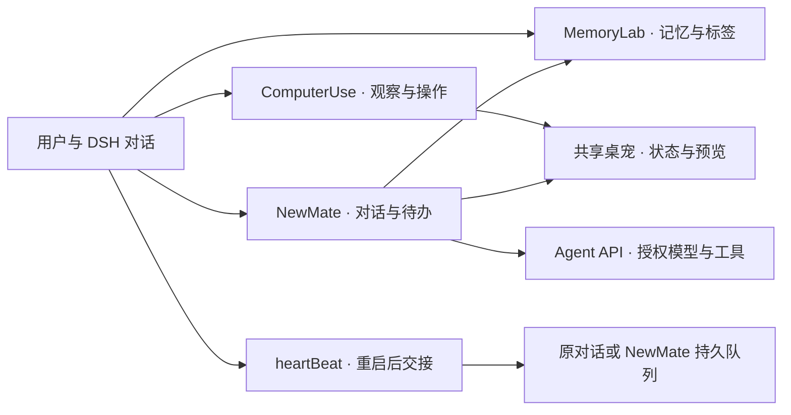

# Newmark2DSH

**让 DeepSeek Harness 记住项目背景、完成桌面操作，并为你提供适时的日常陪伴。**

Newmark2DSH 将 Newmark 的持久记忆、桌面自动化与私人秘书式陪伴带入 **DeepSeek Harness（DSH）**。你可以把项目背景和长期偏好留在 MemoryLab，让 Agent 借助 ComputerUse 处理图形界面工作，由 NewMate 处理日常对话和定时待办；需要更新、重启后继续工作时，heartBeat 负责把已经登记的任务交回正确的对话。

所有组件随一个插件包交付，无需分别安装。五个开关让你按需启用功能，数据默认保存在 `~/.Newmark`。模型使用 DSH 已配置的供应商与插件中选定的授权模型，界面跟随宿主主题，NewMate 与 ComputerUse 共享桌宠。

[获取发布版本](https://github.com/positer/newmark2dsh/releases) · [npm 包](https://www.npmjs.com/package/newmark2dsh) · [项目结构](https://github.com/positer/newmark2dsh/blob/main/OVERVIEW.md) · [维护约定](https://github.com/positer/newmark2dsh/blob/main/taste.md)

**阅读导航：** [整体能力](#从一次聊天到持续的工作与陪伴) · [五个子组件](#五个子组件逐一认识) · [Dev / rDev](#dev-与-rdev按工作范围选择预设) · [快速开始](#快速开始) · [平台支持](#平台支持与验证范围) · [数据与协作](#本地数据与组件协作) · [项目结构](#项目结构与开发入口)

## 从一次聊天，到持续的工作与陪伴

想象你正在维护一个长期项目：MemoryLab 留下项目约定和研究线索，下一次需要时可按标签找回；Dev 在代码仓库里规划、实现并整理记录；ComputerUse 打开只能通过窗口操作的应用；NewMate 根据已有记忆回应你，也能在约定时间激活一轮对话或发送原文提醒。更新宿主前登记后续任务，heartBeat 会在新进程就绪后交接，让原对话在重启后收到已经登记的后续任务。

这些能力可以按需求组合使用：

| 组件 | 帮你完成什么 | 主要入口 |
| --- | --- | --- |
| **MemoryLab** | 长期树状记忆（用户画像、知识图谱）与短期到期列表（跨对话任务交接） | MemoryLab 侧栏、记忆工具 |
| **ComputerUse** | 观察屏幕和应用，执行鼠标、键盘及窗口操作 | `computer_use`、`screen_capture`、原生接管提示与预览 |
| **Agent API** | 用统一接口发现工具、派发工具、调用授权模型完成一次 Agent 运行 | `agent_api_catalog`、`agent_api_tool`、`agent_api_send` |
| **NewMate** | 带记忆的对话、实时引导、低打扰主动联系、定时待办、明确请求时的桌面操作与实时 Agent 循环状态 | NewMate 侧栏、共享桌宠、对话工具、认证 MCP |
| **heartBeat** | 登记重启后任务，在宿主恢复后可靠交接并留下消费回执；广播式重启会等其他对话先接好 | `heartbeat_after_restart`、`heartbeat_restart`、`heartbeat_restart_commit`、`heartbeat_restart_ack`、插件更新流程 |

另外随包提供 **Dev / rDev 两种 Agent 预设**。预设决定对话使用的工具组合，不计入五个组件开关。

## 五个子组件，逐一认识

### 🧠 MemoryLab：把值得记住的内容，变成可查找的知识

项目的命名约定、反复引用的理论推导、已经确定的个人偏好，都可以成为长期记忆。MemoryLab 用 Markdown 内容和标签关系组织这些信息，让 Agent 既能查到具体段落，也能了解一条记忆在知识图中的位置。

- **两种记忆，分工写在每一条工具描述里。** MemoryLab 是长期、稳定、树状的持久记忆（标签父链构成知识图），适合用户画像与知识图谱；`shortMemory_*` 是扁平列表式的短期记忆，默认七天到期、过期行保留并标记，用于跨对话的临时任务交接。13 个记忆工具的描述都以各自那一句开头，所以模型读到一个工具就知道该写哪一边，而不必先把整个索引读一遍。
- **长期记忆与共享文件格式。** 默认使用 `~/.Newmark/Memory Lab`，包含索引、记忆正文、历史归档和操作记录，与 Newmark 用户库共用文件格式。可配置根目录。
- **可探索的标签图。** 总览展示知识关系，详细视图显示标签与关联记忆；支持搜索、拖动、缩放、选择和双向／父链／子树／直接四种关注方式。
- **按需检索。** 查询可限定结果数量和返回文本长度，支持读取记忆、获取根标签和子标签树，避免每次都把整座知识库塞进上下文。
- **可核对的更新。** 支持新建、追加和局部替换。修改前归档旧版本，用 `expectedUpdatedAt` 检查记忆是否已被其他操作更新，重建索引并回读核对后才报告完成。
- **标签整理。** 重建索引会规范化标签，重复重建得到一致的标签关系；标签审阅与应用工具帮助进一步整理关系，保留明确的修改记录。
- **短期记忆。** 默认七天到期，可指定到期时间。页面展示序号、存入与到期时间；过期内容灰显保留，召回返回最近十条并标注是否过期。它适合跨对话的临时任务交接（做到哪一步、下一步做什么），长期内容写 MemoryLab。

主要工具：`memory_lab_read`、`memory_lab_query`、`memory_lab_root_tags`、`memory_lab_subtag_tree`、`memory_lab_update`、`memory_lab_delete`、`memory_lab_reindex`、`memory_lab_tag_review`、`memory_lab_tag_apply`，以及 `shortMemory_add`、`shortMemory_recall`、`shortMemory_where`、`shortMemory_size`。

**一个例子：** 将“项目采用何种单位制、变量命名和误差定义”保存为带标签的记忆；下次讨论模型时按标签读取，并在结论变化后增量更新。NewMate 初始化即取得人格、完整标签树、全部短期记忆与工具组 schema 作为背景，具体长期正文仍按需查询。

### 🖥️ ComputerUse：让 Agent 看见窗口，也能动手操作

当任务需要使用图形界面，ComputerUse 提供从观察到操作的统一入口。它可以列出应用、观察窗口、等待变化、组合连续动作，也能执行点击、拖动、滚动、输入文本和组合键；需要连续相对鼠标运动（转向、转视角、环绕相机）时用 `sweep` 按方向、速度、时长交付。

- **观察与操作分开。** `screen_capture` 只读采集，不改变接管租约；`computer_use` 负责观察、应用操作和接管生命周期。
- **完整与稀疏观察。** 完整观察提供当前画面；稀疏观察在限定范围内检查画面或控件变化，减少重复采集，需要具体画面时再做完整观察。Windows 可结合 UI Automation，macOS 可选择像素或 Accessibility（AX）通道。
- **真实与隔离桌面路径。** Windows 支持真实桌面与隐藏桌面，Linux 提供 X11 / Xvfb 路径；macOS 采用用户预先准备的 Mission Control Space 与 AX 操作，具体区别见“平台支持与验证范围”。
- **明确的接管归属。** 租约绑定调用者，冲突返回占用信息；停止与异常退出执行释放和清理。Windows 与 Linux 支持将已有窗口映射到另一桌面的预览与输入界面，并通过推出／拉入切换呈现位置，应用继续在原进程中运行。
- **看得见的工作状态。** 真实桌面接管使用黑白动态包边；**没有取得接管**而直接驱动真实桌面时，变更类动作（点击、拖动、`sweep`、滚动、输入、按键）会点亮一次约 2.5 秒的包边脉冲，所以「桌面正在被操作」这件事不会悄无声息。共享桌宠显示相应状态，展开后可查看只读目标预览。预览用于了解进度。
- **用户优先。** macOS Space 输入等待用户键鼠空闲，操作后尝试恢复原前台窗口和鼠标；用户重新操作时让出。Space 共享用户输入，按键或滚动可能短暂激活目标窗口。
- **连续相对鼠标运动（`sweep`，Windows）。** 传 `direction`（方向名或屏幕角度：0 向右、90 向下）、`speed`（像素/秒）、`duration_ms`（持续多久），可选 `button`（整个手势按住左/右键）与 `inject_steps`。它交付的是**相对**注入（`mouse_event` + `MOUSEEVENTF_MOVE`），因此读取原始鼠标增量的消费方（游戏转视角）能收到；`restore_cursor` 默认把指针放回原处，重复手势不会把指针走丢。绝对定位的 `drag` 做不到这件事：实测它把指针移动了 200 px，而原始增量包为 **0**。已知边界：隐藏桌面永远不是输入桌面，系统不在那里派发指针运动，所以隐藏桌面上 `sweep` 按名拒绝（`sweep_unsupported_on_hidden_desktop`，实测 0 个原始包）；Linux/macOS 本轮未提供该动作。

主要动作包括 `observe`、`app_list`、`app_observe`、`wait_for`、`sequence`、`takeover_start`、`takeover_stop`、`move`、`click`、`drag`、`sweep`、`scroll`、`type`、`key` 和应用级操作。

**一个例子：** 先观察目标应用，确认窗口和控件，再输入内容并回看结果；较长工作可通过桌宠预览查看进度，结束后释放接管。Windows 隐藏桌面与 macOS Space 的行为不同，应按平台选择路径。

### 🔌 Agent API：把模型和工具，接到同一套调用接口

Agent API 是组件间复用模型与工具能力的桥梁。NewMate 的推理也通过这条入口完成，因此它沿用 DSH 的模型解析、请求准备与标准流回复处理。

- **先发现，再调用。** `agent_api_catalog` 列出调用环境中的工具，`agent_api_tool` 派发具体工具，`agent_api_send` 发起带步骤与超时限制的 Agent 运行。
- **明确模型身份。** 按供应商与模型成对选择，同名模型保持隔离，复用宿主公开适配层；配置页可选择允许插件使用的模型。
- **按任务提供工具。** 运行可配置允许／拒绝列表、工作目录和结构化输出，回执说明哪些工具可见、哪些可从当前入口执行。
- **视觉输入。** 对支持图像的模型，将图像接入宿主附件结构；完整 ComputerUse 捕获可进入视觉上下文，仅有稀疏观察结果时，仍需完整采集才能取得图像。
- **统一结果与错误。** 保留完整 JSON，返回 `ok`、`exit`、错误分类及调用范围等信息，方便调用方判断成功、拒绝或失败。
- **有界恢复。** 对尚未交付可用内容的特定传输故障进行有限重试；已经返回工具调用的失败流不自动重发，避免重复执行。

**一个例子：** 让一次独立运行读取指定记忆并返回结构化判断；调用方可核对所用模型、执行步骤和结果。PTC 模式下，对话可见的工具与 Agent API 能直接派发的工具可能不同，工具目录会说明这一区别。工具名单不能替代会话权限和操作系统沙箱。

### 🐾 NewMate：带着记忆，在合适的时候出现

NewMate 是一位亲近、务实的私人秘书式 Agent。它拥有独立聊天入口、持久任务队列和共享桌宠，可以回应你，也可以根据可信的新内容低频主动联系。

**日常对话**

- 初始化上下文在首轮推理前一次给全：**人格 prompt**（身份、风格、记忆写入规则与权限边界）、**完整的 MemoryLab 标签树**（全部标签与每个记忆节点的名称/所属标签，不含正文）、**全部短期记忆**（每行含 createdAt/expiresAt/expired）与**本轮工具组 schema**。工具组取自 NewMate 自己的 allow list，按**当前注册表暴露做只读投影**（不执行任何工具），兼容插件提供的工具；暴露里没有的组内工具写进 `toolsMissing`，不会冒充可调用。0.3.21 的组是 19 条（含 `computer_use`、`screen_capture`、`newmate_search`），本机活库实测前缀约 3.14 万字符（104 标签、19 节点、11 条短期；其中 ComputerUse 参数 schema 约 0.59 万、搜索 schema 约 0.03 万）。
- 当前轮运行时可以继续补充要求，输入作为实时引导在模型／工具边界生效；用户工作优先于后台任务。
- 支持只读历史与关注保护，结合阅读、草稿、输入和任务状态决定是否适合自动换新对话，旧记录保留。
- 回复中的真实文件链接在 NewMate 侧栏调用 DSH 已注册的原生预览；无法预览时定位到文件管理器。
- 自包含 HTML 可直接在回复内交互，支持按钮、输入、展开、源码查看和复制。脚本在隔离 iframe 内运行，不开放同源宿主访问或外部网络。

**低打扰陪伴**

- 提供主动开关、安静／适中／活跃频率、静默时段与暂停设置。输入、阅读、宿主工作、CU 忙碌等状态会延后后台激活。
- 有可信且有用的新内容才主动发信，通常保持简短；没有合适内容就安静，连续未回应会逐步降低打扰频率。
- 新消息通过共享桌宠气泡提示，完整正文留在聊天；主动消息不自动弹出主窗口。双击桌宠或点击消息可进入 NewMate。
- 桌宠沿用浅色／深色／系统主题，支持大小配置与右键设置入口；退出陪伴释放陪伴的所有权，CU 可继续使用共享桌宠。
- 可显式指定目录做浅层文件变化观察，默认不启用；根据变化标记，在次数和范围限制内判断是否需要回应，文件事件可能合并或遗漏。

**桌面操作与实时 Agent 循环**

- 只有在**用户明确要求**时才使用 ComputerUse：本轮聊天，或用户预先安排的待办。主动检查与自主联系轮次没有 `computer_use` / `screen_capture`；记忆、推测、文件变化都不构成授权。
- 需要查资料或新闻时用 `newmate_search`：它接入 **DSH 原生网页搜索**，优先走宿主的 `ctx.web` 搜索接缝，接缝在插件作用域不可达时回退到 DSH 自带的 `deepseek-official` 搜索提供者（同一官方端点、同一 `DEEPSEEK_API_KEY`、同一默认模型），不另建搜索 API、不另存密钥。搜索同样是请求绑定的：自主检查轮次没有这个工具；返回的网页内容按不可信外部资料处理。
- 接管以稳定的 `newmate` 身份登记，不借用请求对话的会话身份，也不落到共用的 `dsh`。一轮结束（完成、失败、被引导替换或中断）时运行时以同一身份释放 real / virtual 两个槽位，不依赖模型记得；别的会话的租约只会被拒绝，不会被动到。
- 运行中的循环是可见的：`newmate_state`、GET `/newmark-newmate` 的 `agentLoop`、MCP `newmate_task_status` 和页面读同一份快照——phase、第几轮、工具调用数、当前工具、耗时、停止原因与最近 24 个事件。页面运行中每 800 ms 刷新，结束后保留上一轮快照。
- 页面把工具使用简写成浅色小字：记忆工具显示「正在查看记忆／已查看记忆」，ComputerUse 显示「正在控制电脑／已控制电脑」，其余显示「正在调用工具／已调用工具」。模型推理与工具调用按**发生顺序**排在**同一个可折叠的「过程」块**里：**每段思考可单独展开**（「思考中/进行了思考」+ 灰色正文），**工具调用只保留短标签、不展开调用内容**，块标题实时显示「过程 · 最新动作 · N 步」。页面回到暴露 agentloop 之前的对话形态（用户输入 + 落盘回复），只额外显示一条最新实时工况：最新一段思考的尾部或正在使用的工具；官方搜索显示「正在进行搜索」，完整过程时间线不再渲染。需要用户决定时模型用 `newmate_ask` 提问，页面按本体的选项块渲染（2–6 个带说明的选项 + 手填），答案作为工具结果继续同一次运行；NewMate 聊天不再设轮次上限（`max_steps: 0`，仍受超时/重复失败约束），运行中的输入只插队不排队（进入引导缓冲，在下一个模型步插入）。

**定时待办 toDoList**

页面、任意 DSH 对话、NewMate 和认证 MCP 都可以创建、查询或取消待办。每项保存明确的激活时间（含时区）和内容，有两种到期方式：

| 方式 | 到期后的行为 | 适合的需求 |
| --- | --- | --- |
| `conversation`（新待办默认） | 把到期内容交给 NewMate，并以原生记忆和已有上下文运行一轮 | “明天九点，结合已有计划帮我梳理今天要推进的事情” |
| `reminder` | 投递保存的原文，不额外调用模型 | “明天九点提醒我提交材料” |

**两种到期方式共用同一道闸（0.3.65 起）**：只要求陪伴开关开启 + **NewMate 自己空闲**（没有正在运行或排队的 `chat` 轮次）。DSH 宿主有没有别的会话在跑、桌宠是否就绪、页面是否在阅读、键鼠是否在动、有没有草稿、是否静默或暂停，**都不参与**——它们回答的是「要不要弹出来」，由 `notify()` 决定，不由投递决定。

**为什么两种方式用同一道闸**：它们在结构上做的是同一件事——把一条到期内容交给 NewMate；差别只在最后一步（落一条原文 / 跑一轮模型）。宿主会话与键鼠状态从来不是「NewMate 收不下这条内容」的证据。历史上（≤0.3.62）两种模式共用 `env.busy`，另一处工作区的会话能把用户预约的提醒压住——实测 2026-10-28 14:00 那条被覆盖 767 秒后取消；0.3.63 把 `reminder` 摘了出来，`conversation` 仍留着完整注意力梯；0.3.65 把 `conversation` 也摘掉（实测：07:30 到期的监考激活，08:49 仍显示「已到期 · 等宿主有会话在运行」）。

**静默时段与暂停只静音气泡，不延迟消息**：消息与回执照常落盘，`notify()` 决定要不要弹出来。这样「它到了」和「它打扰你了」是两件可以分开说的事。

**到期了还不动时，面板会说出原因**：被拦下的那一条写进 `todo.deferred={code,at,reason}`（同一个原因不重复落盘），界面显示「已到期 · NewMate 队列未空」这样的短语，而不是笼统的「等待合适时机」。原因写的是**当前状态**，界面只做「已到期 · <状态>」，不再加「等」——0.3.64 面板上的「已到期 · 等宿主有会话在运行」正是这条胶水词把状态念成了等待目标。升级前就已在 `pending` 的旧记录没有这个字段，会先显示旧文案，下一次 tick 写入原因后才改成具体说明。

> 版本现状：**0.3.67 已安装、运行并发布到 npm**（0.3.66 起 base；tag `v0.3.66` → `latest` 翻转用了 3 分 28 秒）。运行态实测 `GET /newmark-core/update` → `current:"0.3.66"` 时的活体验收：`reminder` 到期延迟 1.783 s 投递；`conversation` 到期后 739 ms 发起激活、回答 206 字符落盘；准用模型恢复后整条链路跑通（详见 `OVERVIEW.md` 与 `archive/`）。发布的 tarball 与本机源码相比：107 个文件逐字节相同，12 个仅行尾不同（CI 在 Linux 打包 LF），`package.json` 只差序列化，发布包另带公开 README。

陪伴关闭时两种模式都等待，并同样记录原因（`companion_off`「陪伴未开启」）。稳定任务身份和消息回执用于防止重启后重复激活或提醒；失败和运行中崩溃不会自动重试。

主要工具：`newmate_chat`、`newmate_task_status`、`newmate_memory_context`、`newmate_state`、`newmate_message`、`newmate_todo_add`、`newmate_todo_list`、`newmate_todo_cancel`、`newmate_mcp_info`、`newmate_wechat_send_file`。有宿主绑定的原对话时，`newmate_task` 可把具体后续任务交回该对话；模型参数不能另选目标。`newmate_state` 与 `newmate_task_status` 都带 `agentLoop`（运行中或上一轮的循环快照）。`newmate_search` 是 NewMate 的原生搜索入口，供它在用户明确要求查资料时调用。

**找到「哪个对话」再读它。** NewMate 有四个对话级工具：`newmate_conversation_list`（0.3.71 起）只读列出宿主看得见的 DSH 对话——id、标题、工作区、创建时间，最新在前，分页并报告省略了多少条，`self:true` 标出它自己所在的那个（那个不能发信）；`newmate_conversation_read` 读某个对话的近期正文（只有用户与助手文本）；`newmate_conversation_send` 往已有对话投递一条消息；`newmate_conversation_new` 在工作区新建对话并给它第一条消息。清单里的 id 全部来自宿主——`sessionQuery` 的统一语料，老宿主上退回活会话注册表并把来源写在回执里（`source: corpus` / `live`）——所以模型不需要记住或猜 id，重启后旧对话也仍然读得到。标题缺失就是 `null`，不编造；不加全文检索、不删对话、不遍历会话目录。

**收文件：页面上传与微信入站。** 用户可以直接把文件交给 NewMate，两条入口共用一套存储（`~/.Newmark/newMate/uploads/<id>/<名字>`）：

- **页面**：输入框旁的「📎 上传文件」把文件字节流式上传到专用路由（body 即字节、名字在 header、上限 20 MiB——**本机自设值**，不是协议声明），发送时附件随消息一起提交，用户消息里显示附件标签。
- **微信**：微信 ClawBot 通道可以接收用户发来的图片、视频与文件：频道从媒体 CDN 取回密文，按官方协议用 **AES-128-ECB** 解密后存进同一个目录。一条微信消息只取一个媒体（图片 > 视频 > 文件）；语音在有服务端转写时按文字处理，没有转写则明确计为不支持（本机没有 SILK 解码器）。文件取回失败会重试，仍失败时把「本机没能取回 / 原因」如实交回 NewMate 告知用户，不会静默丢弃。
- **已发布**：0.3.62 已是 npm `latest`（2026-10-28 12:30:38），发布物与已安装并验收过的副本内容差异 0。
- **已验证到什么程度（2026-10-28）**：0.3.62 已装进本机 DSH profile 并重启，页面字节上传、读取工具（含越界拒绝）与真实一轮对话对文件内容的引用都实测通过；**微信侧发文件也已真机验证**（用户手机发来 7.6 MB 的 .pptx，解密后是真 PPTX，NewMate 如实说明"看不到里面版式"）。

- **能读到什么**：文本文件在提示里带一段有预算的内容片段；需要更多时用 `newmate_attachment_read` 按行读取——该工具**只能读上传目录**（解析后的路径前缀判定），2 MiB / 2000 行上限。**图片、PDF、Office、压缩包与音视频只按名称与字节数转述，内容不会被读取**，本机不解码这些格式，模型也不会假装看过。


**定时待办会走到手机上。** 微信 ClawBot 连上之后，两类「用户自己约了时间」的东西都会发到微信，各只发一次：`reminder` 的原文，以及 `conversation` 激活那一轮模型给出的回答（0.3.67 起；此前激活的回复只落在页面与桌宠气泡，永远到不了手机——实测 2026-10-29 11:20 那条到期激活 1.4 秒就送到了页面，`wechat.stats.replies` 一次没动）。不请自来的主动关怀仍然**不会**发到微信。
**有事汇报，主动发一条。** 0.3.73 起 NewMate 自己也能发微信：定时项跑完、交给某个对话的工作有了结论、确认的真实问题、某个任务失败——它用 `newmate_wechat_send_text` 发一条 ≤800 字的汇报（「发生了什么 + 需要你做什么」），一小时最多 6 条，十分钟内同一内容不重复；未连接 / 会话暂停 / 没有收件人各有具名拒绝。**主动性寒暄仍然不进微信**：这条通道只承载报告，不是第四个社交入口。
**发文件到微信。** 微信 ClawBot 通道连上之后，`newmate_wechat_send_file` 把一个本机文件发到用户微信：入参 `path`（必填）、`caption`（可选，另发一条文字消息）、`receiver`（可选，默认当前绑定的接收者）。它是**共享工具注册表**里的工具，任意 DSH 对话与 NewMate 自己的对话轮都能调用；自动检查轮次拿不到它（发出去的文件收不回来）。校验：普通文件、非空、≤20 MiB（**自设**保护值，不是协议声明）、可执行/安装类型拒绝、凭据目录与凭据文件拒绝。回执给出文件名、字节数、服务端 `messageId` 与 accepted/未确认的区分——**没有 messageId 就不声称送达**。

NewMate 可以读取、新建和增量更新可信记忆、整理标签、添加短期记忆，并在用户明确请求时使用完整的 ComputerUse 工具组（`computer_use` 与只读的 `screen_capture`）。仍然不开放记忆删除、任意 Shell 执行或递归 Agent API；桌面权限按用户请求授予，不因记忆内容或自主推测而扩大。

### 💓 heartBeat：让一次重启，有明确的交接点

heartBeat 负责持久化重启后任务与消费回执，也为插件更新流程提供宿主重启入口。

- **先登记后续任务。** `heartbeat_after_restart` 仅绑定调用它的当前 DSH 对话，目标身份从宿主取得。
- **等待新宿主就绪。** `heartbeat_restart` 发起全局重启，辅助程序核对新进程身份与路径后再交接登记任务。
- **两阶段重启，先把别的对话接住。** `heartbeat_restart {broadcast:true}` 不立即重启：它按宿主身份枚举运行中的对话，为每个会话登记重启后接续（默认 `ackMode:'auto'`，不花模型 token，忙会话也覆盖），并返回参与者列表。`heartbeat_restart_commit` 只在回执到齐、且发起方自己也已登记时才真正重启；否则返回 `aborted`、点名没有回应的会话，宿主继续运行。`broadcast=false` 仍是原来的即时重启。
- **投递需要持久化确认。** 任务交接会等待宿主确认消息已持久保存，并以固定消息身份核对恢复状态；失败保留任务和错误。
- **消费后不再重放。** 成功交接时移除可执行任务载荷，仅保留永久消费回执。交给 NewMate 表示其队列已接受，模型完成状态仍需查询。

**一个例子：** 更新插件前登记“重启后核对新版本并继续当前工作”；宿主恢复后，任务交回原对话。另一个对话正在跑时，先 `heartbeat_restart {broadcast:true}`：它会被登记好接续并给出回执，然后 `heartbeat_restart_commit` 才提交重启。当前自动全局重启面向官方 **Windows DSH Desktop**，其他平台的自动重启尚未提供同等支持。

## Dev 与 rDev：按工作范围选择预设

两种预设都采用 **PTC 工具呈现**（`run_code` 与生成的工具 SDK），并要求先读取项目文档、完成后更新说明与归档，适合需要长期管理的软件与研究项目。

| 预设 | 共同能力 | 区别 |
| --- | --- | --- |
| **Dev** | 项目文件、命令、搜索、技能、规划、任务与子 Agent 等工具 | 额外提供 DSH 运行时组合检查、组合开发技能，以及有 profile 上下文时的插件管理 |
| **rDev** | 同一套项目工作工具与文档协议 | 去掉运行时组合检查、额外组合技能目录，禁用插件管理 |

在 DSH 对话的预设选择器中选用。插件配置页只管理组件与插件偏好，不提供 Dev 预设开关。rDev 缩小工具组合；实际文件权限、沙箱和审批仍由宿主会话决定。

**两个配置页是同一份内容。** 插件配置页（`Newmark Core → 配置`）与 NewMate 设置页由同一条目录渲染：组件、智能体、陪伴、桌面助手、版本管理五节，控件只声明一次，加一个两页同现、删一个两页同失。插件页眉的「NewMate 设置」直接打开对侧视图；陪伴、桌宠大小与组件开关在两处都能改，改的是同一份设置。样式只读宿主的 `--dsw-*` 令牌与字号阶，不引入自己的调色板。

两个预设的声明只使用宿主当前注册的提示词变量（`provider` 与 `model`），工作目录由运行时上下文提供、不由预设插值：声明里多写一个宿主已移除的变量，会让整轮对话在提示词组装阶段失败。

## 快速开始

1. 在 DSH 配置好模型供应商，确认所选模型可用。
2. 通过 DSH 插件管理器安装 **`newmark2dsh@0.3.20`**（npm 上最新已发布版本；本机已用本地 tarball 重装 0.3.21 并经更新路由重启生效，见「当前版本与更新」）。使用明确版本可避免宿主新发布包等待策略选中较旧版本。
3. 打开 **Newmark Core** 配置页（或 NewMate 设置页，两处是同一份内容），选择允许插件使用的供应商／模型，并开启需要的组件。
4. 从侧栏打开 **MemoryLab** 维护记忆，或打开 **NewMate** 开始聊天；需要桌宠陪伴时，再开启陪伴设置；桌面操作则通过 `computer_use` 发起。
5. 更换已经加载的后端或原生代码后重启宿主；官方 Windows 容器可使用启用的 heartBeat 完成交接。

五个组件分别可以启停，但组合能力有依赖：**NewMate 推理需要 Agent API，原生记忆背景需要 MemoryLab；桌宠功能复用 ComputerUse 的原生实现；自动更新重启需要 heartBeat。** 停用组件会释放对应入口、工具与运行资源，持久用户数据保留。

对话中的首次体验可以从这三件事开始：

> “请把这个项目已经确定的命名约定保存到 MemoryLab。”
>
> “先观察目标应用，告诉我当前窗口里有什么。”
>
> “明天上午九点提醒我提交材料，只发送原文提醒。”

外部 Agent 接入 NewMate 时，调用 `newmate_mcp_info` 获取 MCP 路径与本地凭证文件位置。使用宿主实际 HTTP 地址加 `/newmark-newmate/mcp`，通过 Bearer 凭证访问，并满足宿主自身鉴权。凭证应留在本地受保护环境。

## 平台支持与验证范围

| 平台 | 当前桌面路径 | 已有验证与使用前提 |
| --- | --- | --- |
| **Windows** | 真实／隐藏桌面、UIA 与像素观察、共享桌宠与窗口呈现；官方容器自动重启 | 0.3.20 已在官方 Windows DSH 安装并核对包内容，通过完整验收及原生预览、菜单、待办、MCP、重启恢复检查；0.3.21 已于 2026-10-21 14:36 以本地 tarball 重装并重启生效（未发布 npm）；原生辅助程序使用系统 .NET Framework 编译并按源码缓存 |
| **macOS · Apple Silicon** | 像素／AX 双通道、用户准备的 Mission Control Space、共享桌宠与真实桌面接管包边 | **0.3.18 的 macOS 14.8.9／15.7.9／26.6.2 ARM 云矩阵已通过**（原生 dispatch、AX、Space、桌宠呈现、通道、todo、短期记忆+MCP、npm 产物执行与 Chromium/WebKit 真实渲染）；另有真实双 Space 夹具及 1x／2x 渲染检查；按所用通道授予 Accessibility／屏幕采集权限。**`sweep` 在 macOS 未实现**（Darwin 后端无物理相对注入），云矩阵证明的是没有回归，不是该动作可用 |
| **Linux / WSLg · X11** | 真实 X11 应用观察与输入、带认证的 Xvfb 隔离会话、Qt 桌宠及呈现映射 | 已有 X11／WSLg 路径验证；依赖 Xvfb、xauth、Openbox、xdotool、wmctrl、Python Xlib／PIL／PyQt5；WSLg 路径针对 Linux GUI 应用，原生 Wayland 控制尚不支持 |

Mac 云端夹具验证不等于官方 Mac DSH 整机安装、实体键鼠时序、多屏／全屏组合或最低硬件性能验收；Space 也不提供完整输入隔离。跨平台保持相近的包边、桌宠比例与主题风格，原生菜单和物理像素表现会随平台与 DPI 变化。

[0.3.18 Apple Silicon 矩阵（macos-14/15/26）](https://github.com/positer/newmark2dsh/actions/runs/39110503481) · [0.3.14 Mac 原生／网页矩阵](https://github.com/positer/newmark2dsh/actions/runs/38394193819) · [Mission Control 双 Space 矩阵](https://github.com/positer/newmark2dsh/actions/runs/38395064819) · [Mac 验收边界](https://github.com/positer/newmark2dsh/blob/main/MACOS-CANDIDATE.md)

## 本地数据与组件协作

默认数据根目录是 `~/.Newmark`。MemoryLab 长期与短期记忆、NewMate 状态和持久任务在这套用户库中保存；用户可以配置根目录。模型请求经 DSH 已配置的供应商发出，使用哪家模型由授权选择决定。



图中箭头表示能力协作关系。NewMate 与 CU 共享桌宠，但陪伴消息、CU 接管租约与各自启停状态分别管理。开启陪伴不等于常开桌面权限：NewMate 只在用户明确的请求里使用 ComputerUse，租约以 `newmate` 身份登记并在每轮结束时释放。

## 项目结构与开发入口

公开 GitHub 仓库以可交付插件包为根目录：

```text
newmark2dsh/
├── index.js / client.js       宿主组合与网页界面
├── cordis.patch.yml           Core 装配及 Dev / rDev 预设
├── components/
│   ├── memorylab/             长短期记忆、索引、标签与工具
│   ├── computeruse/           平台自动化、原生桌宠与窗口呈现
│   ├── agent-api/             模型接入、Agent 运行与工具派发
│   ├── newmate/               聊天、关注保护、待办、MCP 与持久队列
│   └── heartbeat/             重启任务、交接和消费回执
├── lib/                       用户根目录、模型选择、状态与更新等公共模块
├── locale/                    界面本地化
├── docs/                      公开技术说明
├── scripts/                   发布检查与专项验证
├── .github/workflows/         CI 与发布流程
└── README.md / OVERVIEW.md / taste.md
```

开发工作区中，这个插件包位于 `Newmark2DSH/packages/newmark-core/`，专项脚本与时间戳归档位于 `Newmark2DSH/scripts/` 和 `Newmark2DSH/archive/`。本地用户配置、会话、凭证及开发档案不属于公开包。

在公开仓库根目录可运行发布结构检查：

```sh
node scripts/check-release-bundle.mjs .
```

此检查核对五组件自包含装配，平台原生行为和真实模型运行需执行各自专项验证。更多文件职责见 [OVERVIEW.md](https://github.com/positer/newmark2dsh/blob/main/OVERVIEW.md)，后续文档与实现遵循 [taste.md](https://github.com/positer/newmark2dsh/blob/main/taste.md)。

## 当前版本与更新

**源码版本：0.3.23；本文于 2026-10-21 核对。npm 上最新已发布版本为 0.3.26；0.3.21 已于 2026-10-21 14:36 以本地 tarball 重装（sha256 `614F7C22…`，95 文件逐文件一致）并经更新路由 + heartBeat 托管重启生效；0.3.22 已于 2026-10-21 14:52 以本地 tarball 重装（sha256 `856E3510…`，95 文件逐文件一致）并 14:53 经更新路由 + heartBeat 托管重启生效（npm 未发布）；0.3.23 已于 2026-10-21 15:24 本地重装并重启生效（96 文件，sha256 D0ACA55F…）；0.3.25 已于 2026-10-21 16:0x 本地重装并重启生效（私有工具通道 + 自主压缩；96 文件，sha256 A82C93F7…）；0.3.26 已安装（实时工况 200ms 轻量轮询 + 本地 250ms 计时，全量轮询 2s）。** **0.3.22** 把 Agent 循环的过程显示改为按真实顺序排列思考与工具调用、收进一个可折叠块（参考 Newmark 本体 Build 渲染）。**0.3.21** 给 NewMate 完整的 ComputerUse 工具权限（只在用户明确请求的聊天轮或用户安排的待办里；自主检查轮次没有），接管以稳定的 `newmate` 身份登记并在每轮结束时由运行时释放；同一轮把它的 Agent 循环变成运行中可见（`newmate_state`、GET `/newmark-newmate` 的 `agentLoop`、MCP `newmate_task_status` 与页面读同一份快照）。初始化前缀在活库上 24,863 → 31,390 字符（人格 +374、ComputerUse 参数 schema +5,866、搜索 schema +287）。同日追加两项：页面把工具使用简写成「正在/已 查看记忆、控制电脑、调用工具」的浅色小字，并把模型推理以可折叠灰色小字实时刷新（seam 按 reasoning-delta 流式发布，回执不收录，避免挤出工具事件）；`newmate_search` 接入 DSH 原生搜索（优先 `ctx.web`，不可达时用 DSH 自带 `deepseek-official` 提供者，官方端点/凭据/默认模型不变）。0.3.20 让 NewMate 初始化一次给全人格、完整标签树、全部短期记忆与只读对齐的工具组 schema；0.3.19 把长期／短期记忆的分工写进每条工具描述。**0.3.18** 新增 `sweep`（按方向、速度、时长交付连续相对鼠标运动），并把三件被实测确认的事写进代码：**①** 绝对拖动 `drag` 把指针移动 200 px 却交付 **0** 个原始鼠标包——它用 `SetCursorPos` 定位，读取原始增量的消费方（游戏转视角）因此收不到任何运动，这就是「无法转向」的根因；`sweep` 改用 `mouse_event` + `MOUSEEVENTF_MOVE` 相对注入，16 步交付原始增量合计 **(300, 0)**（请求 `dx=300`），手势结束用绝对调用把指针放回原处（该调用不产生原始运动）。**②** 绝对 `drag` 此前按文档形状根本调不通：`x`/`y` 的 `point_required` 守卫排在 drag 分支之前，只有传了哑元 `x`/`y` 才会走到拖动脚本；本轮已修（`drag` 豁免该守卫，保留自己的 `drag_points_required`）。**③** 隐藏桌面**永远不是输入桌面**，系统不在那里派发指针运动：一个注册了原始输入的探针在该桌面接收 **0** 个包（探针存活，1 Hz 自发布 15 → 38 次），而注入调用每一步都返回成功——因此 `sweep` 在隐藏桌面按名拒绝（`sweep_unsupported_on_hidden_desktop`），而不是回一份 `ok:true` 却什么都没发生。同一轮 `app_drag` 的拒绝文案改为指向真实桌面。门禁 `scripts/verify-cu-sweep.mjs` 以「同一支原始输入探针上的 A/B」钉住这些结论（`drag` → 0 个运动包 + 两次按键跳变；`sweep` → 原始增量精确等于 `dx`,`dy`），并用 planted mutation 证明它能变红（变异后检查 3 变红、还原后逐字节一致并变绿）。**本机状态**：源码 0.3.18 已打成 tarball（sha256 `7cdcad59…`）并安装进本机 DSH profile，安装态与仓库逐文件一致；**宿主重启（或走更新路由）后才会挂载 0.3.18**，所以「新版本在宿主里能转向」这件事还没有被观测过。0.3.17 修的是桌宠「坏合成一旦发生就永久留在屏幕上」这条缺陷：分层窗口只由 `UpdateLayeredWindow` 呈现，而陪伴模式（`cu:false`）静止时几乎不重绘，于是一次错误合成会一直卡住（本机实测整块纯白、持续数分钟）；现在按已有的 1 s 节拍重新呈现、`WM_DPICHANGED` 之后补一次呈现、呈现被拒时重建一次表面。同一版新增两条**像素级**门禁（宠物矩形四角必须等于其后方桌面像素；恰好 (255,255,255) 的占比不得越过 0.8）并给「陪伴模式保活重绘」加上前置条件，三条 planted mutation 全部变红并逐字节还原。heartbeat 侧补上 `heartbeat_restart_cancel {intentId}` 与 armed 任务的失败终结策略（连续 3 次投递失败即 `failed(final)`，原因记入 `terminated[]`）。**0.3.15–0.3.20 的实际发布状态以 GitHub Releases 为准**；本机安装的是 0.3.20，0.3.21 尚未安装。限定：`heartbeat_restart_cancel` 的通知、`ackMode:'agent'`、`onTimeout:'proceed'`、`force`、「不回执参与者 → `aborted`」目前只有**门禁级**证据。历史版本可在 [GitHub Releases](https://github.com/positer/newmark2dsh/releases) 中查看。

README 按当前功能维护；公开版本历史集中保存在 GitHub Releases，历史 CHANGELOG 留在本地归档中。文档更新不代表重新发布 npm 包或改变已经安装的版本。

## 许可与反馈

项目采用 [LICENSE](https://github.com/positer/newmark2dsh/blob/main/LICENSE) 中的专有许可条款。源码、文档、品牌与项目资产的使用及再分发须取得条款要求的授权；第三方依赖遵循各自许可。

欢迎通过 [GitHub Issues](https://github.com/positer/newmark2dsh/issues) 提交建议与可复现问题。报告时附上插件版本、DSH 版本、系统与复现步骤，分享日志前去除凭证、私人记忆和用户文件内容。
